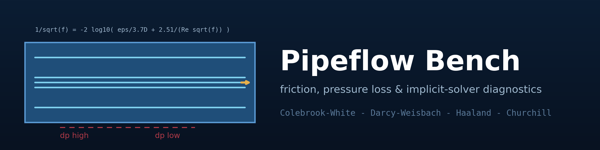
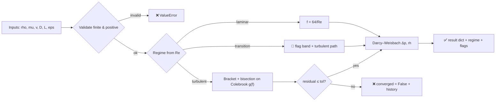
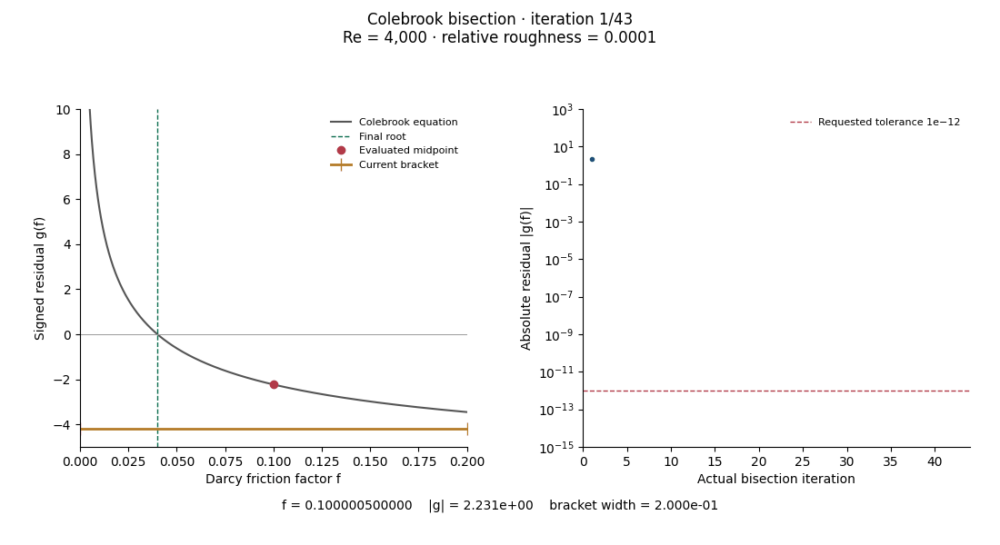

<div align="center">



# 🚰 Pipeflow Bench

### Friction, pressure loss & implicit-solver diagnostics for pipe flow

**An original Python tool that solves the implicit Colebrook–White equation by bracketed
bisection — with visible residual histories, regime flags, and the root verified against
its own equation to 1e-12.**

[](https://github.com/khalil-work/pipeflow-bench/actions/workflows/ci.yml)
[](LICENSE)
[](requirements.txt)
[](tests)
[](docs/verification.md)
[](https://github.com/khalil-work/pipeflow-bench/stargazers)
[](https://github.com/khalil-work/pipeflow-bench/commits)

[Quick start](#-quick-start) · [Method](#-model-method-and-diagnostics) · [Results](#-results-gallery) · [Verification](#%EF%B8%8F-verification) · [References](#-references)

</div>

---

## 🎯 Purpose and scope

A transparent pipe-flow pressure-loss tool built around an **honestly solved implicit
friction relation**: the Colebrook equation is solved by bracketed bisection with visible
residual histories and explicit regime/transition-band flags, and explicit approximations
(Haaland, Churchill) are carried as comparison references — never as the solver.

> **Scope:** single-phase incompressible fully developed flow in circular pipes.
> No minor losses, compressibility, or non-circular ducts — every exclusion is stated,
> nothing is silently approximated.

| | |
| --- | --- |
| 🔬 **Physics** | Darcy friction factor across laminar, transition and turbulent regimes |
| 🧮 **Numerics** | Bracketed bisection with validated brackets and full residual histories |
| 🔍 **Diagnostics** | Transition-band flag, stagnation detection, equation-satisfaction check |
| 📊 **Evidence** | 39 tests, CSV traces, verification report, animated solver convergence |

## 🧮 Model, method, and diagnostics

| Regime | Reynolds | Treatment |
| --- | --- | --- |
| Laminar | Re < 2300 | Exact law **f = 64/Re** |
| Transition | 2300 ≤ Re < 4000 | **Flagged**; turbulent correlation applied with the band recorded |
| Turbulent | Re ≥ 4000 | **Colebrook–White by bisection** on g(f) = 1/√f + 2 log₁₀(ε/3.7D + 2.51/(Re√f)) |

The solver validates its bracket, requires the requested residual before returning
`converged=True`, and returns the complete residual history; budget exhaustion or
floating-point stagnation returns an explicit `False`. Pressure loss follows
Δp = f (L/D) ρv²/2 with ṁ = ρvπD²/4 and finite-positive validation throughout.

### How a solve flows through the library



Full details: [docs/model.md](docs/model.md) · API: [docs/api.md](docs/api.md)

## ⚡ Quick start

```bash
python -m pip install -r requirements-dev.txt
python -m pytest tests -q                       # 39 verification tests
python examples/run_verification.py             # figures + GIF + raw data
```

<details>
<summary><b>📦 Verified environments</b></summary>

Verified: Python 3.13.5, NumPy 2.1.3, Windows 11; CI on Ubuntu. Tests complete in
under 1 s locally; generation runtime is recorded in `docs/results/run_summary.json`.

</details>

<details>
<summary><b>🧱 Repository layout & API example</b></summary>

```
pipeflow_bench/
└── colebrook.py        # regime logic, implicit solver, references, pipeline
tests/test_colebrook.py # 39 verification tests
examples/run_verification.py
docs/ model.md  api.md  verification.md  results/
```

```python
from pipeflow_bench import solve_pipe

result = solve_pipe(rho=998.0, mu=1.0e-3, v=1.5, D=0.05, L=100.0, eps=4.5e-5)
print(result["Re"], result["regime"], result["friction_factor"], result["dp_Pa"])
# 74850.0 turbulent 0.022531362454543326 50594.17439167704
```

</details>

## 📊 Correlations carried in the box

| Correlation | Type | Role here |
| --- | --- | --- |
| **Colebrook (1939)** | Implicit | The solved reference root |
| **Haaland (1983)** | Explicit | Comparison band — max 1.34% off Colebrook in the recorded sweep |
| **Churchill (1977)** | Explicit, all regimes | Full-range cross-check (< 4%, laminar limit exact) |
| **Blasius** | Explicit, smooth turbulent | Smooth-pipe comparison (< 5%) |

## ✅ Verification

39 test cases: equation-satisfaction at the returned root, analytic fully-rough limit,
Blasius/Haaland accuracy bands, monotonicity, transition band flagging, exact hand
pressure loss, input validation. Evidence and limits: [docs/verification.md](docs/verification.md).

> **Not claimed:** correlation-vs-nature accuracy (Colebrook is an empirical relation);
> anything outside fully developed incompressible pipe flow.

<details>
<summary><b>🔍 Repaired failure cases</b></summary>

- At Re=10⁷ and zero roughness, a width-based early exit previously claimed success at
  |g|=1.031e-9 for a requested tolerance of 1e-9. Success now requires the requested
  residual; excessively tight tolerance yields an explicit false flag on finite-precision
  stagnation.
- NaN roughness at Re=3,000 previously produced a nonfinite residual with a true
  convergence flag. Invalid roughness is now rejected before every regime branch,
  including laminar flow.
- The comparison plot now uses numerical Reynolds numbers from its CSV, and the
  animation's range contains the actual root and evaluated probes.

[Stopping-regression data](docs/results/stopping_regression.csv)

</details>

## ⚠️ Limitations

- Empirical correlations: solver correctness ≠ physical accuracy of the correlation.
- Transition band results are flagged approximations.
- No minor losses / fittings / networks.

---

## 🎞️ Results gallery

<div align="center">

**▶ Watch the implicit solver converge:**



<sub>43 frames of the recorded bisection residual history on the implicit
Colebrook–White equation (Re = 4·10³, ε/D = 10⁻⁴); the dashed line marks
the converged root. Produced by <code>examples/run_verification.py</code>.
Each frame adds a real evaluated solver state; the left plot shows the
equation, current probe and bracket, the right the full residual history.
The final root is f=0.0400084312335583 with absolute residual 2.1e-13 —
iteration progression, not time.</sub>

[▶ Open the 43-frame GIF directly](docs/results/root_convergence.gif) ·
[Actual brackets, midpoints and residuals](docs/results/bisection_trace.csv)

</div>

### 📈 Verified metrics

| Case | Metric | Value |
| --- | --- | --- |
| Colebrook root vs its own equation (Re 4e3–1e7, ε/D 0–1e-2) | max residual | **≤ 1e-12** |
| Fully-rough limit vs analytic | relative offset at Re=1e8 / 1e9 | 1.6e-5 / 1.6e-6 (viscous-term physics quantified) |
| Haaland vs Colebrook (recorded sweep) | max relative difference | **1.34%** |
| Churchill (1977) vs Colebrook, Re 4e3–1e8 & ε/D 0–0.05 | max relative difference | **< 4%**; laminar limit exact (f → 64/Re) |
| Blasius vs smooth Colebrook | relative difference | < 5% |
| Darcy-Weisbach vs hand computation | error | exact (4.0e4 Pa case) |
| Operating point v=1.5 m/s, D=50 mm | Re / f / Δp per 100 m | 74,850 / 0.0225314 / 50.59 kPa |

### 🖼️ Static figures & raw data

- [friction_chart.png](docs/results/friction_chart.png) — friction factor vs Reynolds
  across regimes with the transition band marked
- [pipeline_sweep.png](docs/results/pipeline_sweep.png) — operating-point sweep with a
  second view of the low-speed regimes so flagged transition data are visible
- [residual_history.png](docs/results/residual_history.png) — solver residual history
- Raw CSVs: `explicit_comparison.csv`, `residual_history.csv`, `pipeline_sweep.csv`,
  `run_summary.json` in [docs/results/](docs/results)

## 📚 References

- S. W. Churchill, "Friction factor equation spans all fluid-flow regimes"
  (Chemical Engineering, 1977) — full-range explicit comparison.
- S. E. Haaland, "Simple and explicit formulas for the friction factor in
  turbulent pipe flow" (1983).
- C. F. Colebrook, "Turbulent flow in pipes" (1939).
- L. F. Moody, "Friction factors for pipe flow" (1944) — the Moody chart.
- Darcy–Weisbach framework as consolidated in modern fluid-mechanics texts.

Dependencies: NumPy (BSD-3), Matplotlib (PSF-based), Pillow (HPND), pytest
(MIT). This repository's own code is original and MIT-licensed; see
[LICENSE](LICENSE).

[Calendar metadata disclosure](docs/CALENDAR_HISTORY.md).
